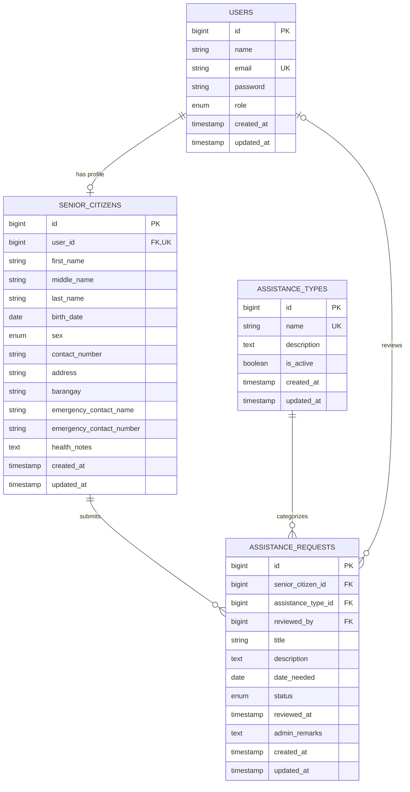

# Entity relationship diagram

`senior_citizens.user_id` is unique, so each account can be associated with at most one senior profile. A user registered as a senior receives that profile during registration. Requests belong to a senior profile and an assistance type. `reviewed_by` references the admin user who last reviewed a request and becomes null if that user is deleted.

Application roles are `admin` and `senior_citizen`. The `senior` value from the original schema is migrated to `senior_citizen`; it is not an application role.

Senior profiles with requests are protected from deletion by the API. The database currently cascades request rows when a senior profile is deleted, so the controller check is necessary to preserve request history.
